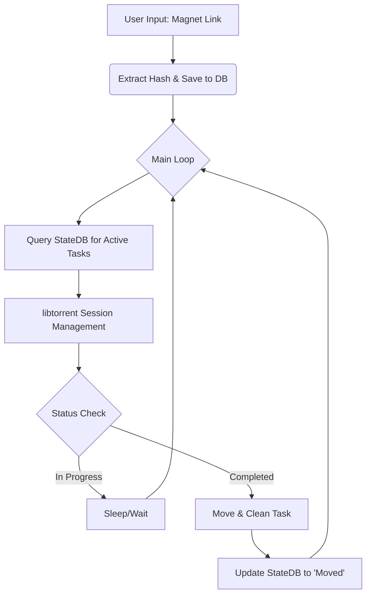

# Technical Design Document: Automated Torrent Management System (ATMS)

## 1. Introduction
The purpose of the ATMS is to automate the workflow of downloading torrents via magnet links, managing them concurrently in a dedicated temporary directory, and automatically moving completed content to a final media repository while preserving folder structures and ensuring state persistence.

## 2. Problem Statement
Manual management of large-scale downloads often leads to:
- **Data Fragmentation**: Files remaining in download folders after completion.
- **Structural Loss**: Failure to preserve nested subfolders during move operations.
- **Interruption Risks**: Losing progress on long downloads if the script/system restarts.
- **Resource Overhead**: High CPU usage from inefficient polling of torrent statuses.

## 3. System Architecture Overview
The system follows a modular "State-Driven" architecture. Instead of just running a linear script, it maintains a database of tasks that transition through states (Pending -> Downloading -> Completed -> Moved).

### 3.1 Component Diagram (Logic Flow)

---

## 4. Module Specifications & Reasoning

### 4.1 Configuration Manager (`config_loader.py`)
- **Responsibility**: Load `DOWNLOAD_PATH` and `MEDIA_LOCATION`.
- **Reasoning**: Using `.env` files ensures that paths are not hardcoded, making the script portable across different machines or user profiles without modifying the source code.

### 4.2 State Database (`state_manager.py`)
- **Responsibility**: Track every magnet link by its unique hash.
- **States**: `PENDING`, `DOWNLOADING`, `COMPLETED`, `MOVED`.
- **Reasoning**: A persistence layer (SQLite/JSON) is critical for "Graceful Recovery." If the system reboots or the script crashes, it can resume exactly where it left off by checking which items are still in a non-final state.

### 4.3 Downloader Engine (`downloader_engine.py`)
- **Technology**: `libtorrent`.
- **Reasoning**: `libtorrent` is chosen because it handles the heavy lifting of DHT, peer discovery, and piece verification. It supports multi-file management within a single session efficiently.
- **Resource Management**: Rather than using a "busy" loop (which consumes 100% CPU), the system will use a timed poll (e.g., every 5–10 seconds) to check the status of the `libtorrent` peer sessions.

### 4.4 Mover Engine (`mover_service.py`)
- **Technology**: `pathlib`.
- **Logic**:
    1.  Identify all files in the completed folder.
    2.  Remove unnecessary metadata (e.g., `.nfo`, `.txt` if specified).
    3.  **Dynamic Path Construction**: Use `pathlib` to create subdirectories dynamically in the destination if they don't exist.
- **Reasoning**: Using `pathlib` handles "Windows quirks" like mixed slashes and trailing spaces automatically, ensuring that nested folder structures are perfectly mirrored into the media directory.

---

## 5. Execution Workflow (Step-by-Step)

### Step 1: Initialization
The script starts, initializes a singleton `libtorrent` session, and loads environmental variables. It checks the local database for any "Downlading" tasks to resume them immediately.

### Step 2: Magnet Acquisition
When a user inputs a link, the system extracts the unique identifier (Hash). This hash is saved into the DB. This ensures that if you try to add the same magnet twice, it can be detected as a duplicate.

### Step 3: The Monitoring Loop
The loop acts as the "brain" of the script:
1.  It queries the database for any items not in 'MOVED' status.
2.  It updates the `libtorrent` progress trackers.
3.  It calculates completion percentages.

### Step 4: Completion & Move (Triggered Event)
When a task reaches 100%:
- The **Downloader** marks it as `COMPLETED`.
- The **Mover** is notified. It performs a "dry run" of the folder structure, creates necessary directories in the destination, and moves files using `shutil` or `os.rename`.
- Upon success, the database updates to `MOVED`.

---

## 6. Handling Edge Cases & Constraints

| Constraint | Strategy | Reason |
| :--- | :--- | :--- |
| **Concurrent Files** | Single `libtorrent` session with multiple peer handles. | Efficiently manages multiple downloads in one process. |
| **Graceful Exit** | `signal` handling for SIGINT/SIGTERM. | Ensures the library releases ports and file locks before closing. |
| **Resource Usage** | Sleep-based polling (e.g., 10s interval). | Prevents "spinning" on a single CPU core, keeping it useful for other tasks. |
| **Windows Pathing** | Standardize on `pathlib`. | Handles long paths and special characters automatically. |

---

## 7. Infrastructure Summary
- **Primary Language**: Python 3.10+
- **Core Library**: libtorrent (via pip)
- **Database**: SQLite / local JSON file
- **Environment Management**: python-dotenv
- **Path Manipulation**: pathlib

---