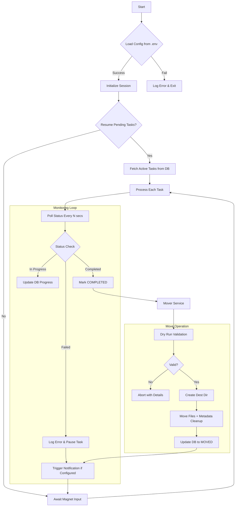

# Technical Design Document: Automated Torrent Management System (ATMS)
## Version 2.0 - Architecture Revision

---

## 1. Introduction
The purpose of the ATMS is to automate the workflow of downloading torrents via magnet links, managing them concurrently in a dedicated temporary directory, and automatically moving completed content to a final media repository while preserving folder structures and ensuring state persistence. This version (v2.0) incorporates refined error handling, security considerations, database design, logging, and backup strategies based on operational requirements.

---

## 2. Problem Statement
Manual management of large-scale downloads often leads to:
- **Data Fragmentation**: Files remaining in download folders after completion.
- **Structural Loss**: Failure to preserve nested subfolders during move operations.
- **Interruption Risks**: Losing progress on long downloads if the script/system restarts.
- **Resource Overhead**: High CPU usage from inefficient polling of torrent statuses.

---

## 3. System Architecture Overview
The system follows a modular "State-Driven" architecture with explicit error handling, recovery mechanisms, and persistence layers. Instead of just running a linear script, it maintains a database of tasks that transition through states (`PENDING` -> `DOWNLOADING` -> `COMPLETED` -> `MOVED`).

### 3.1 Core Design Principles
| Principle | Rationale | Implementation Approach |
| :--- | :--- | :--- |
| **Single-Threaded Efficiency** | libtorrent handles concurrent downloads natively via its internal thread pool; external threading adds complexity without benefit. | Use libtorrent's built-in async callbacks and `set_alert_mask` for polling; avoid spawning separate threads. |
| **Explicit Error Recovery** | Network interruptions, disk full errors, and magnet link failures must be handled gracefully to prevent data loss or system lockups. | Wrap all libtorrent operations in try-except blocks; implement retry logic with exponential backoff for transient errors. |
| **Minimal Resource Footprint** | Downloads should not monopolize system resources; polling intervals must balance accuracy with CPU usage. | Poll status every 5-10 seconds using `libtorrent.session_alert` mechanism; release session handles properly on exit. |
| **Structured Logging** | Debugging and monitoring require timestamped, categorized logs for troubleshooting download issues or move failures. | Implement Python logging module with file rotation (e.g., `RotatingFileHandler`); log all state transitions and errors to separate log files. |

---

### 3.2 Component Diagram (Logic Flow)


---

## 4. Module Specifications & Reasoning

### 4.1 Configuration Manager (`config_loader.py`)
- **Responsibility**: Load `DOWNLOAD_PATH`, `MEDIA_LOCATION`, and optional settings (polling interval, backup path) from `.env`.
- **Reasoning**: Using `.env` files ensures that paths are not hardcoded, making the script portable across different machines or user profiles without modifying the source code.
- **Enhancement**: Add validation for critical paths on startup (check if directories exist or can be created); log warnings for invalid configurations.

### 4.2 State Database (`state_manager.py`)
- **Responsibility**: Track every magnet link by its unique hash; persist task state, progress, and error information.
- **States**: `PENDING`, `DOWNLOADING`, `COMPLETED`, `MOVED`.
- **Reasoning**: A persistence layer (SQLite) is critical for "Graceful Recovery." If the system reboots or the script crashes, it can resume exactly where it left off by checking which items are still in a non-final state.
- **Backup Strategy**: Implement automated weekly SQLite database backups to a dedicated backup path; log backup operations and handle failures gracefully (e.g., retry with exponential backoff).

### 4.3 Database Schema Design
The following schema supports concurrent task tracking, progress monitoring, and error reporting:

```sql
CREATE TABLE torrents (
    id INTEGER PRIMARY KEY AUTOINCREMENT,
    hash TEXT UNIQUE NOT NULL,                    -- Unique torrent identifier
    magnet_link TEXT NOT NULL,                    -- Original magnet link for reference
    status TEXT NOT NULL DEFAULT 'PENDING',       -- Status: PENDING, DOWNLOADING, COMPLETED, MOVED, FAILED
    progress_percent REAL DEFAULT 0.0,            -- Download completion percentage (0-100)
    added_at TIMESTAMP DEFAULT CURRENT_TIMESTAMP, -- When task was added to DB
    completed_at TIMESTAMP,                       -- When download reached 100%
    error_message TEXT,                           -- Last error message if failed/paused
    priority INTEGER DEFAULT 5,                   -- Optional: 1=low, 5=normal, 9=high (for future)
    added_by TEXT,                                -- User/session identifier (optional)
    INDEX idx_hash (hash),                        -- For fast lookups by hash
    INDEX idx_status (status)                     -- For filtering active tasks
);

CREATE TABLE move_history (
    id INTEGER PRIMARY KEY AUTOINCREMENT,
    torrent_id INTEGER NOT NULL,                  -- Foreign key to torrents table
    source_path TEXT NOT NULL,                    -- Original download path
    dest_path TEXT NOT NULL,                      -- Final destination path
    moved_at TIMESTAMP DEFAULT CURRENT_TIMESTAMP, -- When move completed
    dry_run_result TEXT,                          -- 'success', 'failed', 'skipped'
    error_message TEXT,                           -- Error details if move failed
    FOREIGN KEY (torrent_id) REFERENCES torrents(id) ON DELETE CASCADE
);
```

**Schema Rationale**:
- `hash` and `magnet_link` together ensure duplicate detection.
- `status` enables quick filtering for active downloads vs. completed tasks.
- `progress_percent` allows UI dashboards to show real-time download progress.
- `error_message` captures transient failures (e.g., "Disk full", "Invalid magnet link").
- Separate `move_history` table preserves audit trail without bloating the main torrents table.

### 4.4 Downloader Engine (`downloader_engine.py`)
- **Technology**: `libtorrent`.
- **Reasoning**: `libtorrent` is chosen because it handles the heavy lifting of DHT, peer discovery, and piece verification. It supports multi-file management within a single session efficiently.
- **Thread Model**: libtorrent manages its own thread pool internally; we avoid external threading to reduce complexity. Use `session.add_torrent()` with proper handle management.
- **Resource Management**: Rather than using a "busy" loop (which consumes 100% CPU), the system will use a timed poll (e.g., every 5–10 seconds) via libtorrent's alert mechanism (`status.update_interval` parameter).
- **Error Handling**: Wrap all `add_torrent()` calls in try-except blocks; implement retry logic with exponential backoff for transient network errors (e.g., "No peers", "Invalid tracker").

### 4.5 Mover Service (`mover_service.py`)
- **Technology**: `pathlib`, `shutil`.
- **Logic**:
    1.  Identify all files in the completed folder.
    2.  Remove unnecessary metadata (e.g., `.nfo`, `.txt` if specified in config).
    3.  **Dynamic Path Construction**: Use `pathlib` to create subdirectories dynamically in the destination if they don't exist.
- **Reasoning**: Using `pathlib` handles "Windows quirks" like mixed slashes and trailing spaces automatically, ensuring that nested folder structures are perfectly mirrored into the media directory.
- **Safety Checks**: Implement dry-run validation (check source files exist; verify destination paths are writable) before performing actual moves; abort with detailed error logging if validation fails.

### 4.6 Logging Module (`logger.py`)
- **Responsibility**: Centralized logging for all system operations.
- **Implementation**: Python `logging` module with `RotatingFileHandler` (e.g., retain last 10 log files, each max 5MB).
- **Categories**: 
  - `ATMS.CORE` (session lifecycle, session recreation)
  - `ATMS.DOWNLOADER` (download status, peer stats, errors)
  - `ATMS.MOVER` (move operations, validation results)
  - `ATMS.STATE` (database operations, state transitions)
- **Reasoning**: Structured logging enables debugging of race conditions, move failures, and session recreation events without cluttering stdout. Log files can be aggregated for monitoring or shipped to external logging systems if needed later.

### 4.7 Backup Service (`backup_manager.py`)
- **Responsibility**: Automate weekly SQLite database backups to a dedicated backup path.
- **Implementation**: 
  - Create backup directory on first run (create-on-demand).
  - Use `sqlite3.dump()` or `.dump()` command-line tool for lightweight backups.
  - Backup filename: `atms_backup_YYYYMMDD_HHMMSS.db` with timestamp in name.
  - Rotate old backups (keep last 4 weeks; delete older files silently).
- **Reasoning**: Database corruption or accidental deletions could result in lost progress; automated weekly backups ensure quick recovery without manual intervention.

---

## 5. Execution Workflow (Step-by-Step)

### Step 1: Initialization
The script starts, initializes a singleton `libtorrent` session, and loads environmental variables. It checks the local database for any "Downloading" tasks to resume them immediately. **On first run, create database if not exists; log initialization events.**

### Step 2: Magnet Acquisition
When a user inputs a link, the system extracts the unique identifier (Hash). This hash is saved into the DB. Duplicate detection is performed via `hash` field; if duplicate exists, skip adding again and log warning. **Magnet link validation**: Hash extraction is deterministic but content verification requires manual inspection (libtorrent does not provide built-in magnet signature validation); this limitation should be documented for users.

### Step 3: The Monitoring Loop
The loop acts as the "brain" of the script:
1. It queries the database for any items not in 'MOVED' status.
2. It updates the `libtorrent` progress trackers (via async callbacks or status checks).
3. It calculates completion percentages and updates DB accordingly.
4. **Error Handling**: On any failure (e.g., "Disk full", "Invalid magnet"), update error_message and pause task for retry; implement exponential backoff (e.g., 1min, 2min, 5min intervals) before re-adding to session.

### Step 4: Completion & Move (Triggered Event)
When a task reaches 100%:
- The **Downloader** marks it as `COMPLETED` and logs event with timestamp.
- The **Mover** is notified. It performs a "dry run" of the folder structure, creates necessary directories in the destination, and moves files using `shutil` or `os.rename`.
- Upon success, the database updates to `MOVED` and logs completion event.
- **Cleanup**: Optionally remove torrent data from disk (using libtorrent's delete flag) after successful move; this frees disk space automatically.

### Step 5: Graceful Shutdown & Session Recycle
On SIGINT/SIGTERM or script completion:
1. Log shutdown events with final download counts and status summary.
2. Close all libtorrent session handles properly (ensure `session.abort()` is called).
3. Release file locks before exiting.
4. **Session Recycling**: Implement periodic session recreation if session memory exceeds threshold (e.g., every 50 concurrent torrents); on recreation, resume all active tasks from DB with their original settings.

---

## 6. Handling Edge Cases & Constraints

| Constraint | Strategy | Reason |
| :--- | :--- | :--- |
| **Concurrent Files** | Single `libtorrent` session with multiple peer handles per torrent. | Efficiently manages multiple downloads in one process; libtorrent's internal thread pool handles concurrency. |
| **Graceful Exit** | `signal` handling for SIGINT/SIGTERM + proper session cleanup. | Ensures the library releases ports and file locks before closing; prevent port conflicts on restart. |
| **Resource Usage** | Sleep-based polling (5–10s interval) via libtorrent alerts. | Prevents "spinning" on a single CPU core, keeping it useful for other tasks. |
| **Windows Pathing** | Standardize on `pathlib` + handle long path limits (`EnableLongPaths` registry if needed). | Handles long paths and special characters automatically; avoids mixed slash issues. |
| **Database Corruption** | Weekly automated backups + transactional SQLite (ACID compliance). | Ensures quick recovery from corruption; rollback to last backup if DB becomes unreadable. |

---

## 7. Infrastructure Summary
- **Primary Language**: Python 3.10+
- **Core Library**: libtorrent (v2.x) via pip (`pip install deluge-libtorrent` or `pip install python-libtorrent`)
- **Database**: SQLite (local file; no external server required)
- **Environment Management**: python-dotenv (`python-dotenv` package)
- **Path Manipulation**: pathlib + shutil for moves
- **Logging**: Python logging module with RotatingFileHandler
- **Backup Strategy**: Weekly automated SQLite dumps to dedicated backup path

---

## 8. File Structure
```
ATMS/
├── config_loader.py          # .env loading & validation
├── state_manager.py          # DB operations, CRUD for torrents table
├── downloader_engine.py      # libtorrent session management, alert handling
├── mover_service.py          # Folder structure creation, file moves
├── logger.py                 # Centralized logging setup
├── backup_manager.py         # Weekly SQLite backups
├── main.py                   # Entry point (signal handling, loop orchestration)
├── .env                      # Configuration (paths, polling interval)
└── logs/                     # Rotating log files
    ├── atms.log              # General system events
    ├── downloader.log        # Download-specific events
    └── mover.log             # Move operation logs
```

---

## 9. Version History
| Version | Date | Changes |
| :--- | :--- | :--- |
| **v1.0** | Initial | Basic architecture with single-threaded loop; no error handling, logging, or backups. |
| **v2.0** | Revision | Added explicit error handling, database schema, logging strategy, weekly backup, dry-run validation; simplified thread model; dropped unused features (notifications, seeding, bandwidth scheduling). |

---

## 10. Appendix: Key Design Decisions Summary

| Feature | Decision | Rationale |
| :--- | :--- | :--- |
| **Threading Model** | Single-threaded with libtorrent's internal pool | External threading adds complexity; libtorrent is designed for multi-peer handling natively. |
| **Error Handling** | Wrap all libtorrent ops in try-except with retry logic | Transient network errors should not fail the entire script; exponential backoff prevents overwhelming peers. |
| **Database Security** | Local SQLite with standard permissions | Project is local-only; no external access required; OS file permissions protect against accidental overwrites. |
| **Magnet Validation** | Hash extraction only (no signature validation) | libtorrent does not provide magnet signature verification; users must verify content manually if needed. |
| **Rate Limiting** | Not implemented | User explicitly requested unlimited throughput; respect ISP policies via system-level bandwidth control instead. |
| **Notification System** | Not included in v2.0 | Deferred to future versions (v3.x); complexity outweighs immediate need for local-only usage. |
| **Session Recycling** | Memory-threshold-based recreation | Prevents memory leaks from long-running sessions; resume tasks automatically on restart. |

---

*Document prepared: 2024-10-15*  
*Next review date: End of first deployment cycle or upon significant feature addition*